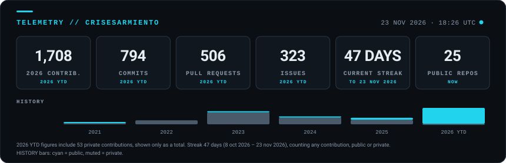
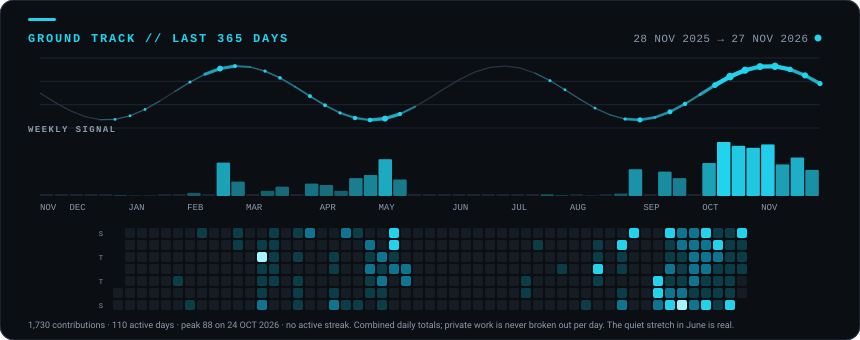
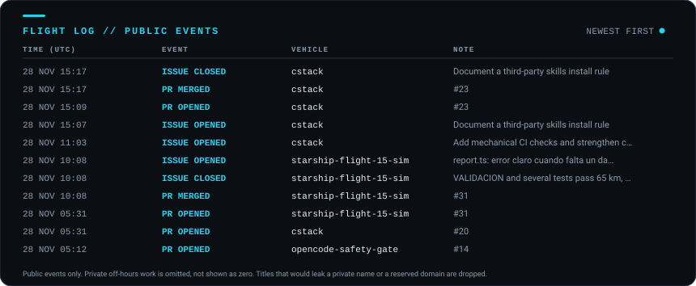
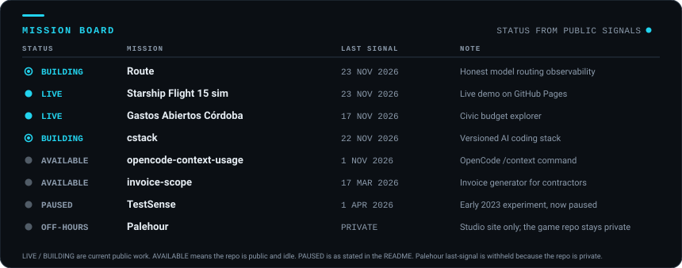
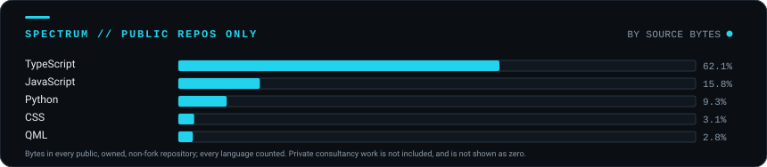
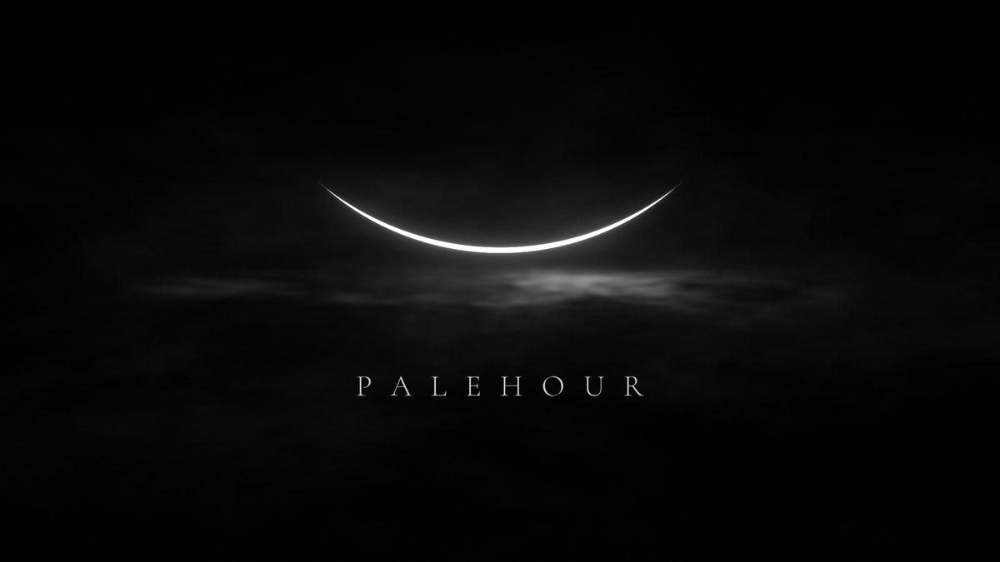

<!-- Profile README for @crisesarmiento -->

  <picture>
    <source media="(prefers-color-scheme: dark)" srcset="assets/header-dark.svg">
    <source media="(prefers-color-scheme: light)" srcset="assets/header-light.svg">
    
  </picture>

  <a href="https://portfolio.testsense.ai">Portfolio</a> ·
  <a href="https://linkedin.com/in/cristianesarmiento">LinkedIn</a> ·
  <a href="https://cristiansarmiento.substack.com">Substack</a> ·
  <a href="https://x.com/crisesarmiento">X</a> ·
  <a href="https://github.com/sponsors/crisesarmiento">Sponsor</a> ·
  <a href="https://ko-fi.com/cristiansarmiento">Ko-fi</a>

I'm Cristian, a software engineer in Córdoba, Argentina, with 12+ years of shipping software.
The first seven were at INVAP, on satellite missions. Since then I've built backends,
full-stack apps and test infrastructure, mostly in healthcare and logistics. These days most of my work is making AI-assisted engineering
reliable: tools that show what an agent actually did, and workflows that don't hide failures.

## Now

- Leading AI-assisted engineering and delivery at a software consultancy.
- Building **Route** on nights and weekends.
- Running OpenCode and Orca workflows on Linux (Omarchy) and macOS, with my stack versioned in [cstack](https://github.com/crisesarmiento/cstack).
- Working on early-stage agent tools: webhook routing with hookroute and safety checks with opencode-safety-gate.

## Building

### [Route](https://github.com/crisesarmiento/useroute) · honest model routing observability
A local-first dashboard for [OpenCode](https://opencode.ai) routing. It shows the suggestions,
context, routes, usage and errors that the logs can actually prove, and nothing more.

- Unknown is shown as unknown, never as zero. Partial and missing data have their own states.
- Demo data is always labeled `DEMO`.
- Binds to `127.0.0.1` only, no telemetry, and never reads credential files.

`TypeScript` · `Bun` · `Electron` · MIT

### [Starship Flight 15 sim](https://github.com/crisesarmiento/starship-flight-15-sim) · unofficial · [Live demo](https://crisesarmiento.github.io/starship-flight-15-sim/)
An interactive three.js walkthrough of Starship Flight 15 built from public data: launch,
hot staging, boostback, live osculating orbit, Starlink deployment and the tower catch.
Every telemetry value carries its source and a confidence level
(official, reported, estimated, computed, interpolated).

> Educational approximation. Not affiliated with or endorsed by SpaceX.

`TypeScript` · `three.js` · `WebGL` · MIT

### [Gastos Abiertos Córdoba](https://crisesarmiento.github.io/gastos-abiertos-cba/) · unofficial civic project
A static site that turns the official budget-execution files of the Province of Córdoba into
something you can browse. It uses a polite scraper, DuckDB and Parquet, and plain HTML with no CDN.
Data from the provincial transparency portal; not an official government site.
([code](https://github.com/crisesarmiento/gastos-abiertos-cba))

`Python` · `DuckDB` · MIT

### Early stage

- [hookroute](https://github.com/crisesarmiento/hookroute): a local, stateless webhook router for coding agents, routing by repo, state and conditions with dedupe and cooldown. Spec first; runtime code is not published yet.
- [opencode-safety-gate](https://github.com/crisesarmiento/opencode-safety-gate): a configurable, fail-closed OpenCode plugin for allow / ask / deny checks on shell commands and agent edits. Pre-0.1, with a spec and test cases; implementation proceeds through small issues, one PR each. Independent community project, not official OpenCode.

Smaller tools

- [opencode-context-usage](https://github.com/crisesarmiento/opencode-context-usage): a `/context` command for OpenCode that shows what's eating your context window.
- [cstack](https://github.com/crisesarmiento/cstack): a versioned AI coding stack — skills, principles and OpenCode presets.
- [repo-template](https://github.com/crisesarmiento/repo-template): a template for my repos — labels, issue and PR templates, community files and setup docs.
- [TestSense](https://github.com/crisesarmiento/testsense): AI-assisted test gap analysis for TypeScript codebases. An early 2023 experiment, now paused.
- [omarchy-mgame-mixer](https://github.com/crisesarmiento/omarchy-mgame-mixer) and [omarchy-elgato-camerahub](https://github.com/crisesarmiento/omarchy-elgato-camerahub): Omarchy bar widgets for my audio interface and cameras.
- [invoice-scope](https://github.com/crisesarmiento/invoice-scope): invoice generator for contractors (Next.js, Prisma, Postgres, one-command Docker boot).
- [anno-1800-expert-buddy](https://github.com/crisesarmiento/anno-1800-expert-buddy): a local web app and Spanish-language desktop companion for an Anno 1800 campaign.

## Background

- **INVAP, 2013–2019, on site at CONAE (SAOCOM mission support).** I built the SAOCOM Mission Simulator (C++ core, Python + Qt GUI, and the API between them).
  I ran power-subsystem operations for ARSAT-1 and ARSAT-2 during launch and orbit maneuvers,
  monitored SAOCOM-1A/1B thermal, and wrote telemetry analysis tools.
- **Healthcare and logistics, 2019–2025.** Four years at a major US healthcare company, where I started as a developer and ended up leading the team,
  building serverless APIs and micro frontends on AWS under SOC 2 / HIPAA. I also built a Cypress
  QA framework from scratch that 40+ people still use, a constraint-based therapy scheduler for a US autism therapy center
  (Python, PuLP/HiGHS), and a rebuild of the tracking extranet for a major Argentine logistics company.
- **AI work, 2026.** Prompt design and code review on AI projects through a US tech talent platform.
- **Early career, 2008–2013.** Help desk, then QA, including QC at Globant (Playdom/Disney).

## Toolbox

TypeScript · Python · Node/NestJS · FastAPI · React/Next.js · PostgreSQL · AWS · Terraform ·
Playwright/Cypress · C++ when it's earned · OpenCode and agent workflows

## Mission Control

These panels are generated from my GitHub data and committed to this repository by a daily Action. They are not live remote widgets. Private contribution counts appear only as a total. Private off-hours work is omitted, not shown as zero.

  <picture>
    <source media="(prefers-color-scheme: dark)" srcset="assets/mission-control/telemetry-dark.svg">
    <source media="(prefers-color-scheme: light)" srcset="assets/mission-control/telemetry-light.svg">
    
  </picture>

  <picture>
    <source media="(prefers-color-scheme: dark)" srcset="assets/mission-control/ground-track-dark.svg">
    <source media="(prefers-color-scheme: light)" srcset="assets/mission-control/ground-track-light.svg">
    
  </picture>

  <picture>
    <source media="(prefers-color-scheme: dark)" srcset="assets/mission-control/flight-log-dark.svg">
    <source media="(prefers-color-scheme: light)" srcset="assets/mission-control/flight-log-light.svg">
    
  </picture>

  <picture>
    <source media="(prefers-color-scheme: dark)" srcset="assets/mission-control/mission-board-dark.svg">
    <source media="(prefers-color-scheme: light)" srcset="assets/mission-control/mission-board-light.svg">
    
  </picture>

  <picture>
    <source media="(prefers-color-scheme: dark)" srcset="assets/mission-control/spectrum-dark.svg">
    <source media="(prefers-color-scheme: light)" srcset="assets/mission-control/spectrum-light.svg">
    
  </picture>

## Off-hours

I'm building a city builder in Godot at [Palehour](https://palehour.github.io/), my small game studio (private for now, just for fun), and my cats supervise.

